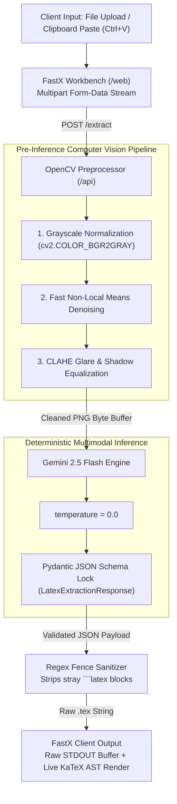
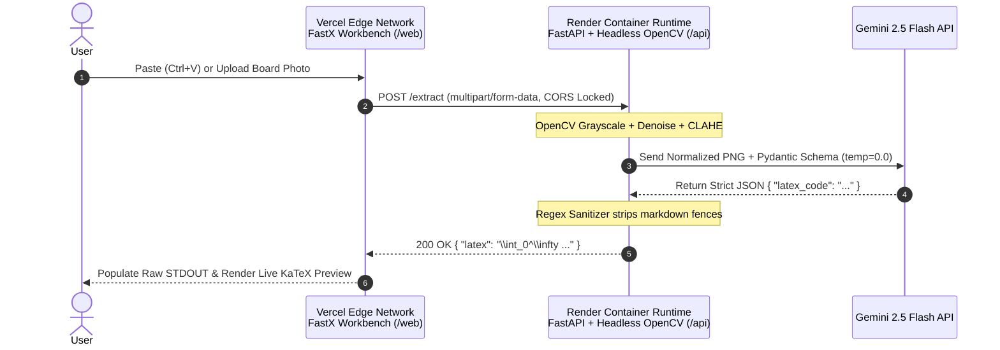

# FastX // Deterministic Optical LaTeX Transcriber

I built **FaStX** to solve a recurring friction point in technical workflows: transcribing handwritten equations, derivations, and matrices from whiteboards or notebooks into compilable LaTeX without dealing with conversational AI filler.

Most LLM-wrappers treat optical math recognition like a chat session—returning markdown fences, unsolicited explanations, or hallucinated symbols caused by phone camera glare. I engineered **FaStX** as a strict, deterministic extraction pipeline that pairs an **OpenCV preprocessing engine** with **schema-constrained multimodal inference**, wrapped inside a zero-fluff, keyboard-first developer workbench.

---

## System Architecture & Extraction Workflow

I designed **FastX** as a decoupled monorepo with a Next.js TypeScript workbench (`/web`) and a FastAPI computer vision + inference microservice (`/api`).



### Key Engineering Decisions

1. **Pre-Inference Computer Vision Pipeline (`preprocess.py`):** Phone photos of whiteboards suffer from ceiling-light glare, perspective shadows, and sensor grain. Before passing bytes to the vision model, I run the raw buffer through OpenCV (`cv2.fastNlMeansDenoising` followed by Contrast Limited Adaptive Histogram Equalization via `cv2.createCLAHE`). This flattens lighting gradients and isolates marker/pen strokes.
2. **Zero-Hallucination Output Contract (`main.py`):** Relying on prompt engineering alone to suppress conversational output is brittle. I enforced determinism at three levels:
   * Set inference `temperature=0.0` to eliminate token sampling variance.
   * Locked the model output to a strict `Pydantic` response schema (`LatexExtractionResponse`) via `response_mime_type="application/json"`.
   * Added a post-processing regex sanitizer to guarantee raw, un-fenced `.tex` syntax.
3. **Utilitarian Workbench UI (`page.tsx`):** I avoided typical AI boilerplate (gradients, chat bubbles, hero landing pages) and built a single-screen split workbench inspired by industrial developer tools. It supports global `ClipboardEvent` listeners (`Ctrl+V` / `Cmd+V`) for instant screenshot ingestion and renders live mathematical verification alongside raw `STDOUT` using `KaTeX`.

---

## Repository Structure

```text
fastx/
├── api/                        # FastAPI + OpenCV + Gemini Backend
│   ├── main.py                 # API routes, Pydantic schema lock, regex sanitizer
│   ├── preprocess.py           # OpenCV grayscale, denoising, and CLAHE pipeline
│   └── requirements.txt        # Headless production Python dependencies
└── web/                        # Next.js (App Router) + TypeScript Workbench
    ├── app/
    │   ├── page.tsx            # Split-pane UI, clipboard listener, KaTeX renderer
    │   └── layout.tsx          # Root layout & monospace typography config
    ├── package.json
    └── tsconfig.json
```

---

## Local Development Setup

### Prerequisites
* **Python** `3.11+`
* **Node.js** `20+` & `npm`
* **Gemini API Key** (`GEMINI_API_KEY`)

### 1. Run the FastX Extraction Engine (`/api`)

```bash
cd api
python -m venv venv
source venv/bin/activate  # On Windows: venv\Scripts\activate
pip install -r requirements.txt

export GEMINI_API_KEY="your_api_key_here"  # On Windows CMD: set GEMINI_API_KEY="your_api_key_here"
uvicorn main:app --reload --port 8000
```

The API service will be live at `http://localhost:8000`.

### 2. Run the FastX Workbench (`/web`)

Open a second terminal session:

```bash
cd web
npm install
npm run dev
```

Open `http://localhost:3000` in your browser. Upload a whiteboard/notebook photo or press `Ctrl+V` / `Cmd+V` with an image in your clipboard.

---

## Production Deployment Flow

I architected the **FastX** deployment to separate compute-heavy OpenCV image processing from edge-cached static frontend delivery.



### Step 1: Backend Deployment (Render / Container Runtime)
1. Provision a new **Web Service** pointing to the `/api` root directory.
2. Use `opencv-python-headless` in `requirements.txt` to avoid missing X11/GUI system library crashes in headless Linux containers.
3. Configure runtime settings:
   * **Build Command:** `pip install -r requirements.txt`
   * **Start Command:** `uvicorn main:app --host 0.0.0.0 --port $PORT`
4. Inject `GEMINI_API_KEY` as a secret environment variable.
5. Copy the provisioned production URL (e.g., `[https://fastx-api.onrender.com](https://fastx-api.onrender.com)`).

### Step 2: Frontend Deployment (Vercel)
1. Import the repository into Vercel and set the **Root Directory** to `web`.
2. Add the backend endpoint to the project environment variables:
   ```env
   NEXT_PUBLIC_API_URL=https://fastx-api.onrender.com
   ```
3. Deploy to production and add the resulting Vercel domain to the `allow_origins` CORS whitelist in `api/main.py`.

---

## API Specification

### `POST /extract`
Accepts a raw image file, executes OpenCV normalization, and returns strict LaTeX code.

* **Content-Type:** `multipart/form-data`
* **Form Field:** `file` (`image/png`, `image/jpeg`, `image/webp`)

**Response (`200 OK`):**
```json
{
  "latex": "\\int_{0}^{\\infty} e^{-x^2} \\, dx = \\frac{\\sqrt{\\pi}}{2}"
}
```

---

## License

MIT License. Built and maintained by [Your Name].
